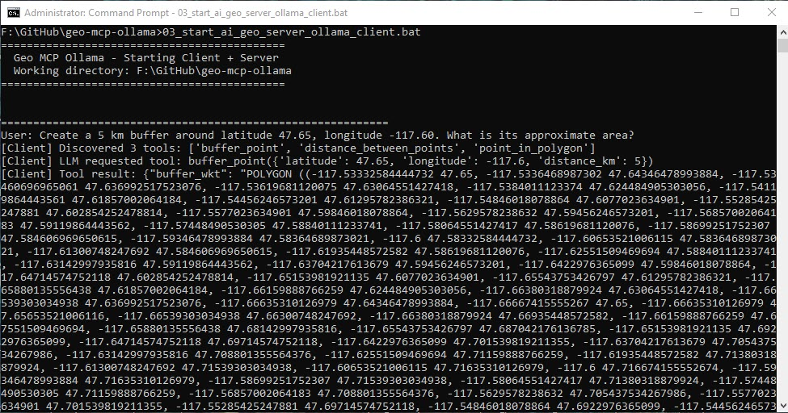
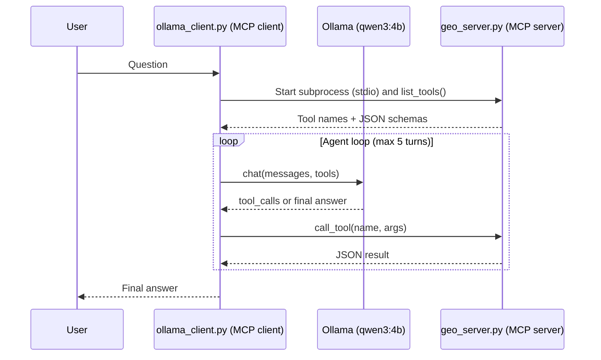

# [AliSoft](https://hodhods.com) Geo MCP Ollama
# By Dr. Ali Abbas aabbas7@gmail.com
# Programming Language: Python

**Geo MCP Ollama**
[](https://youtu.be/lrVTjMdzm8E)

A fully local AI assistant that answers GIS questions by calling real geospatial tools.
A small LLM running in [Ollama](https://ollama.com) decides which tool to use, a [FastMCP](https://gofastmcp.com) server executes it with [Shapely](https://shapely.readthedocs.io), and the LLM explains the result. No cloud service and no API keys.


## Why this project

Language models are unreliable at precise geometry and distance maths. Instead of letting the model guess, this project gives it a toolbox of exact functions exposed through the **Model Context Protocol (MCP)**. The same server can be reused by any MCP-capable client.

## Architecture



| Component | File | Role |
|---|---|---|
| MCP server | `geo_server.py` | Exposes three GIS tools over stdio (FastMCP + Shapely) |
| MCP client / agent | `ollama_client.py` | Discovers tools, passes them to the LLM, executes tool calls, loops until an answer |
| LLM runtime | Ollama | Serves `qwen3:4b` at `http://127.0.0.1:11434` |

## Available tools

| Tool | Inputs | Output |
|---|---|---|
| `buffer_point` | `latitude`, `longitude`, `distance_km` | Buffer polygon as WKT and its area in km² |
| `distance_between_points` | `lat1`, `lon1`, `lat2`, `lon2` | Haversine distance in km |
| `point_in_polygon` | `latitude`, `longitude`, `polygon_wkt` | `{"inside": true/false}` |

> WKT uses **longitude first, then latitude**: `POLYGON ((lon lat, lon lat, ...))`.

## Requirements

- Python 3.10 or newer
- [Ollama](https://ollama.com/download) installed
- About 4 to 6 GB of free RAM for the 4B model
- Windows for the provided `.bat` launchers (the Python code itself is cross-platform)

## Quick start (Windows)

```bat
:: 1. One-time setup: creates .venv and installs dependencies
01_setup.bat

:: 2. Start Ollama (skip if the Ollama app is already running)
02_start_ollama.bat

:: 3. Download the model (one time, in a new terminal)
ollama pull qwen3:4b

:: 4. Run the client; it starts the GIS server automatically
03_start_ai_geo_server_ollama_client.bat
```

### Linux / macOS

```bash
python3 -m venv .venv && source .venv/bin/activate
pip install -r requirements.txt
ollama serve &                 # if not already running
ollama pull qwen3:4b
export NO_PROXY=localhost,127.0.0.1,::1
python ollama_client.py geo_server.py
```

## Usage

`ollama_client.py` runs two demo questions. Edit the `queries` list in `main()` to ask your own:

```python
queries = [
    "What is the distance between Seattle (47.6062, -122.3321) and Portland (45.5152, -122.6784)?",
]
```

Expected console output for a tool-using question:

```text
[Client] Discovered 3 tools: ['buffer_point', 'distance_between_points', 'point_in_polygon']
[Client] LLM requested tool: distance_between_points({'lat1': 47.6062, 'lon1': -122.3321, ...})
[Client] Tool result: {"distance_km": 234.011}
[Client] Final answer (turn 2)
Assistant: The geodesic distance ... is 234.01 kilometers.
```

Test the tools without any LLM:

```python
import asyncio
from fastmcp import Client
from geo_server import mcp

async def main():
    async with Client(mcp) as c:
        print(await c.call_tool("distance_between_points", {
            "lat1": 47.6062, "lon1": -122.3321, "lat2": 45.5152, "lon2": -122.6784}))

asyncio.run(main())
```

## Project structure

```text
geo-mcp-ollama/
├── geo_server.py                              # MCP server with the GIS tools
├── ollama_client.py                           # MCP client + Ollama agent loop
├── requirements.txt                           # Pinned dependencies
├── 01_setup.bat                               # Create .venv and install packages
├── 02_start_ollama.bat                        # ollama serve
└── 03_start_ai_geo_server_ollama_client.bat   # Run client (spawns the server)
```

## Configuration

| Setting | Where | Default |
|---|---|---|
| Model | `ollama_model` in `main()` | `qwen3:4b` |
| Ollama URL | `ollama_url` in `OllamaMCPClient` | `http://127.0.0.1:11434` |
| Max agent turns | `max_turns` | `5` |
| Proxy bypass | `NO_PROXY` in script 03 and `trust_env=False` in the client | enabled |
| Force CPU | `OLLAMA_LLM_LIBRARY=cpu` (commented in script 03) | off |

## Adding a new tool

Add a typed, documented function to `geo_server.py`. FastMCP turns the signature and docstring into the schema the LLM sees, so write clear docstrings (units, coordinate order).

```python
@mcp.tool
def bounding_box(polygon_wkt: str) -> str:
    """Return the bounding box (min_lon, min_lat, max_lon, max_lat) of a WKT geometry."""
    try:
        return json.dumps({"bbox": shapely_wkt.loads(polygon_wkt).bounds})
    except Exception as e:
        return json.dumps({"error": str(e)})
```

Do not use `print()` in the server: stdout is the MCP transport. Log to stderr instead.

## Known limitations

- **`buffer_point` accuracy.** It converts km to degrees with the longitude factor on both axes, so the buffer is stretched north-south by 1/cos(latitude) and the area is overstated (116.4 km² instead of about 78.4 km² for a 5 km buffer at 47.65°N). Fix: build the buffer geodesically with `pyproj.Geod` (already listed in `requirements.txt` but not yet used).
- **Small models may skip tools.** In testing, `qwen3:4b` answered a buffer-area question by itself instead of calling `buffer_point`. Use a strict system prompt ("you MUST call the matching tool"), `temperature: 0`, or a larger model.
- **Speed on CPU.** `qwen3:4b` resolves to a reasoning ("Thinking") build. On a CPU-only laptop it generated 5 to 7 tokens/s and one question took several minutes. An instruct (non-thinking) model is much faster.
- **Haversine** assumes a spherical Earth (about 0.5% error); use `pyproj.Geod` for ellipsoidal accuracy.
- A new server process is started for every question.

## Troubleshooting

| Symptom | Fix |
|---|---|
| `Python not found` in setup | Install Python 3.10+ and add it to PATH |
| Connection refused on `127.0.0.1:11434` | Start Ollama (`02_start_ollama.bat`) |
| `model "qwen3:4b" not found` | Run `ollama pull qwen3:4b` |
| `address already in use` on `ollama serve` | Ollama is already running; skip that step |
| Proxy-related errors to localhost | Launch through script 03 (sets `NO_PROXY`), keep `trust_env=False` |
| Ollama crash `0xc0000005` | Uncomment `set OLLAMA_LLM_LIBRARY=cpu` in script 03 |
| `Max turns reached without a final answer` | Rephrase the question, raise `max_turns`, or use a stronger model |

## Roadmap

- [ ] Geodesic `buffer_point` using `pyproj.Geod`
- [ ] Input validation and error feedback to the LLM on failed tool calls
- [ ] Interactive chat mode with one persistent MCP session
- [ ] More tools: polygon area, centroid, reprojection, nearest neighbour, GeoJSON layers
- [ ] Automated tests with a scripted fake LLM

## Documentation

A detailed step-by-step guide with diagrams is available in `docs/Geo_MCP_Ollama_Project_Guide.docx`.

## Author

**Dr. Ali Abbas**
Software engineer and researcher (Computer Vision, GIS, UAV systems, embedded and Android development)

- Email: [aabbas7@gmail.com](mailto:aabbas7@gmail.com)
- Website: [aabbas77-web.github.io](https://aabbas77-web.github.io)

Questions, bug reports and collaboration ideas are welcome. Please open an issue or get in touch by email.

## License

This project is licensed under the [MIT License](LICENSE). Copyright (c) 2026 Dr. Ali Abbas.
